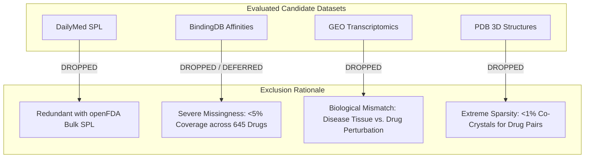

# An Auditable Graphical Fingerprint Framework for Cold-Start Drug-Drug Interaction Prediction

## Benchmark Datasets & Multimodal Representations

This document provides a comprehensive description of the benchmark datasets, multimodal molecular representations, exact architectural mapping, and inclusion/exclusion criteria for **An Auditable Graphical Fingerprint Framework for Cold-Start Drug-Drug Interaction Prediction (AuditDDI)**. It serves as the formal dataset reference for the research manuscript, journal submission, and project documentation.

---

## 1. Academic Dataset Description

> "To evaluate the proposed framework—**An Auditable Graphical Fingerprint Framework for Cold-Start Drug–Drug Interaction Prediction (AuditDDI)**—under auditable, transductive, and cold-start conditions, we utilized the real-world **TWOSIDES** pharmacovigilance benchmark dataset along with the curated **DDInter** interaction resource for external clinical validation. The primary TWOSIDES dataset, derived from the FDA Adverse Event Reporting System (FAERS), contains **4,649,441 pair-event interaction records** spanning **645 small-molecule approved drugs** and **1,317 distinct adverse-event types** (such as gastrointestinal hemorrhage, hyperkalemia, and QT prolongation). These 645 drugs form **63,473 verified interacting drug pairs** (representing 30.56% of all 207,690 possible unordered pairs in the catalog), with unreported pairs serving as split-aware negative controls under per-event negative sampling. For independent clinical validation, we integrated **DDInter**, comprising **382,618 curated interaction pairs** categorized across severity levels. To rigorously evaluate generalization without data leakage, the datasets were partitioned into four mutually disjoint evaluation protocols: **Transductive** (random pair partitioning), **S2 Semi-Cold** (unseen drug-pair split, where one drug is observed during training while the partner is novel), **S1 Cold-Start** (both drugs completely unseen in training: $\text{Drugs}_{\text{train}} \cap \text{Drugs}_{\text{test}} = \emptyset$), and **Scaffold-Disjoint** (where Bemis–Murcko chemical scaffolds in the test set never appear in training). Complete canonical SMILES, 2D molecular graphs, ESM-2 protein target sequences across 2,288 UniProt accessions, and openFDA CYP450 enzyme annotations were aligned across all drugs. The statistical details of the benchmark datasets and evaluation splits are summarized in Table 1."

---

## 2. Table 1: Statistical Summary of Benchmark Datasets and Evaluation Splits

### Part A: Active Benchmark Datasets & Multimodal Representations
| Dataset | Primary Role | Source / Origin | Total Drugs | Drug Pairs | Records / Interacting Events | Label Semantics & Representation |
| :--- | :--- | :--- | :---: | :---: | :---: | :--- |
| **TWOSIDES** | Primary multi-label benchmark & supervision | FDA Adverse Event Reporting System (FAERS) | 645 | 63,473 positive pairs (207,690 total pairs) | 4,649,441 pair-event associations across 1,317 event types | Multi-label adverse events (~863 active classes in training) |
| **DDInter** | External clinical validation & transfer test | Curated scientific literature & clinical guidelines | ~2,000+ | 382,618 pairs | Categorized by severity (Major, Moderate, Minor, Unknown) | Curated clinical interaction consensus |
| **ChEMBL + DrugCentral** | Biological target feature annotations | ChEMBL v33 & DrugCentral mechanisms | 565 covered | 2,288 targets | Verified human protein targets (UniProt accessions) | Mechanism of Action (MoA) target binding |
| **openFDA Bulk SPL** | Metabolism & clearance features | FDA Structured Product Labels (SPL) bulk repository | 406 covered | — | 24-dimensional CYP enzyme profile (8 isoforms $\times$ 3 roles) | Substrate, inhibitor, or inducer flags |
| **UniProt (ESM-2)** | Protein sequence embeddings | UniProtKB (reviewed human accessions) | 563 covered | — | 2,248 FASTA sequences (320-d ESM-2 embeddings) | Evolutionary protein language model representations |
| **PharmGKB** | Pharmacogenomic enzyme & gene features | Curated pharmacogenomics knowledgebase | 241 covered | — | 1,233 pharmacogene and enzyme interactions | Gene interaction profile vectors |
| **PubChem & RxNorm** | Chemical structure & taxonomy identity | PubChem CIDs & RxNorm RxCUIs | 645 covered | — | Canonical SMILES, InChIKeys, ATC classification codes | Structure & taxonomic hierarchy |

---

### Part B: Split Partitioning & Cold-Start Protocols
| Split Protocol | Train Drugs $\cap$ Test Drugs | Pair Leakage | Chemical Scaffold Overlap | Evaluation Purpose | Number of Evaluated Events ($n$) |
| :--- | :---: | :---: | :---: | :--- | :---: |
| **Transductive (`test_all`)** | Overlapping | 0% (Disjoint pairs) | Overlapping | Traditional benchmark; seen drugs in novel combinations | 862 events |
| **S2 Semi-Cold (`test_s2`)** | 1 unseen drug | 0% | Overlapping | Tests novel drug paired with an existing approved drug | 841 – 874 events |
| **S1 Cold-Start (`test_s1`)** | **Strictly $\emptyset$** (Zero) | 0% | Scaffolds may match | Genuine unseen-drug generalization (both drugs novel) | 841 – 874 events |
| **Scaffold-Disjoint (`scaffold_seed0-4`)** | **Strictly $\emptyset$** | 0% | **Strictly 0%** (Bemis–Murcko disjoint) | Hardest benchmark; tests generalization to novel chemotypes | 841 – 874 events |

---

### Part C: Verified 5-Seed Paired Benchmark Results ($n=5$ Seeds)
*Evaluated across 5 independent random splits with paired $t$-tests, Wilcoxon signed-rank tests, and Benjamini-Hochberg (BH) False Discovery Rate control ($q_{\text{BH}}$):*

| Split Family | Test Partition | Feature Representation | Mean AUROC $\pm$ SD | Paired Mean Diff | Seeds Improved | Paired $t$-test $p$ | Wilcoxon $p$ | BH FDR $q$ |
| :--- | :--- | :--- | :---: | :---: | :---: | :---: | :---: | :---: |
| **Scaffold** | `test_s1` (Both Unseen) | ECFP | $0.5214 \pm 0.0159$ | Reference | — | — | — | — |
| **Scaffold** | `test_s1` (Both Unseen) | ECFP + Target + Gene | **$0.5385 \pm 0.0152$** | **$+0.0171$** | **5 / 5** | **$0.0007$** | $0.0625$ | **$0.0056$** |
| **Scaffold** | `test_s2` (One Unseen) | ECFP | $0.6983 \pm 0.0075$ | Reference | — | — | — | — |
| **Scaffold** | `test_s2` (One Unseen) | ECFP + Target + Gene | **$0.7162 \pm 0.0062$** | **$+0.0179$** | **5 / 5** | **$0.0005$** | $0.0625$ | **$0.0056$** |
| **Cold Drug** | `test_s1` (Both Unseen) | ECFP | $0.5356 \pm 0.0117$ | Reference | — | — | — | — |
| **Cold Drug** | `test_s1` (Both Unseen) | ECFP + Target + Gene | **$0.5510 \pm 0.0185$** | **$+0.0154$** | **5 / 5** | **$0.0097$** | $0.0625$ | **$0.0350$** |
| **Cold Drug** | `test_s2` (One Unseen) | ECFP | $0.6984 \pm 0.0066$ | Reference | — | — | — | — |
| **Cold Drug** | `test_s2` (One Unseen) | ECFP + Target + Gene | **$0.7128 \pm 0.0090$** | **$+0.0143$** | **5 / 5** | **$0.0022$** | $0.0625$ | **$0.0114$** |

### Part D: Biological Stratum Ablation Analysis
*Proving that the performance lift on unseen drugs is driven strictly by annotated target biology rather than artifactual noise:*
- **Stratum `bio2` (Both drugs have known biological targets)**:
  - `scaffold test_s1|bio2`: $+0.0222$ AUROC paired gain ($0.5232 \rightarrow 0.5454$, improved in 5/5 seeds, $p = 0.0009$, $q = 0.0056$).
  - `cold_drug test_s1|bio2`: $+0.0218$ AUROC paired gain ($0.5328 \rightarrow 0.5546$, improved in 5/5 seeds, $p = 0.0147$, $q = 0.0439$).
- **Stratum `bio0` (Neither drug has known biological targets)**:
  - `scaffold test_s1|bio0`: paired difference is $+0.0001$ ($p = 0.9793$, $q = 0.9793$, exactly zero effect).
  - `cold_drug test_s1|bio0`: paired difference is $-0.0025$ ($p = 0.5975$, $q = 0.6518$, zero effect).

---

## 3. Exact Dataset-to-Architecture Mapping: Where Each Dataset is Used

To ensure complete reproducibility and scientific clarity, each active dataset maps to a specific computational module in the AuditDDI architecture:

| Dataset | Modality Extracted | Exact Module in Architecture | Code Implementation | Architectural Role |
| :--- | :--- | :--- | :--- | :--- |
| **PubChem** | Canonical SMILES, InChIKeys, 2D molecular topologies | **Edge-Aware GATv2** & **ECFP6 Projection Tower** | `src/models/encoder.py`, `src/baselines/fingerprints.py` | Supplies 44 node / 14 edge features for graphical message passing, and 1024-bit circular fingerprints for global substructure detection. |
| **RxNorm** | RxCUIs & WHO ATC classification codes | **Taxonomic Feature Block** | `src/features/rxnorm_by_name.py`, `src/features/drug_features.py` | Encodes organ system and therapeutic class hierarchies for small molecules. |
| **ChEMBL + DrugCentral** | Curated human protein targets & mechanism flags | **Target Mechanism Tower** | `data/processed/drug_targets_union.csv` | Identifies which human receptor/enzyme families (23 classes) each drug binds to. |
| **UniProtKB** | Amino-acid FASTA sequences for 2,248 targets | **ESM-2 Protein Language Model** | `src/features/uniprot_sequences.py`, `src/features/esm_embeddings.py` | Input sequences embedded with `esm2_t6_8M_UR50D` to generate 320-d MoA-weighted protein embeddings. |
| **openFDA Bulk SPL** | Package insert Section 7 interaction tables & metabolism | **Pharmacokinetic CYP450 Tower** | `src/features/drug_features.py` (`build_cyp_block`) | Feeds 24-dimensional enzyme vectors (CYP1A2, 2B6, 2C8, 2C9, 2C19, 2D6, 2E1, 3A4) for clearance competition. |
| **PharmGKB** | Curated drug-gene interactions | **Pharmacogenomic Interaction Block** | `pharmgkb_twosides_gene_profiles.csv` | Represents interactions with 1,233 metabolic and transporter genes. |
| **TWOSIDES (FAERS)** | Co-prescription adverse event associations | **Supervised Multi-Label Classifier Head** | `src/multilabel/train.py`, `src/models/ddi_model.py` | Forms ground truth labels for ~863 adverse-event heads under class-reweighted BCE loss. |
| **DDInter** | Consensus clinical interaction pairs by severity | **External Validation & Audit Layer** | `src/evidence/external_agreement.py` | Sequestered hold-out evaluation; measures cross-domain agreement against clinical literature. |

### 3.1 Detailed Breakdown: How and Why Each Dataset is Used

#### 1. TWOSIDES (FAERS Spontaneous Reporting)
* **Where It Is Used**: Supervised Multi-Label Output Heads (`src/multilabel/train.py`, `src/models/ddi_model.py`).
* **HOW We Use It**:
  * 4,649,441 pair-event association records across 645 drugs are filtered to freeze a standardized vocabulary of **~863 high-frequency adverse-event heads** ($\ge 500$ occurrences).
  * Each interacting drug pair $(A, B)$ is represented as a high-dimensional binary ground truth vector $\mathbf{y} \in \{0, 1\}^{863}$.
  * Trained under **per-event positive-weighted Binary Cross-Entropy loss** ($\text{pos\_weight}_e = \text{negatives}_e / \text{positives}_e$) with balanced split-aware negative sampling without replacement from unobserved pairs.
* **WHY We Only Use It There**:
  * TWOSIDES describes pairwise clinical adverse events. **It CANNOT be used as an input feature**—providing pairwise interaction signals as inputs would trivially leak the ground truth. It must strictly serve as the multi-label supervision target.

#### 2. PubChem & RxNorm
* **Where It Is Used**: Dual Chemical Encoders (Edge-Aware GATv2 & ECFP6 Fingerprint Tower) and Taxonomic Hierarchy (`src/models/encoder.py`, `src/baselines/fingerprints.py`).
* **HOW We Use It**:
  * **2D Molecular Graphs**: Canonical SMILES from PubChem are converted into molecular graphs with 44 atom features (atomic number, formal charge, hybridization, aromaticity, chirality, valence) and 14 bond features (bond order, stereo, conjugation, ring membership) processed by Edge-Aware GATv2.
  * **Topological Fingerprints**: Circular Extended-Connectivity Fingerprints (**ECFP6**, radius 3, 1024 bits) are projected through a non-linear 2-layer neural tower.
  * **Taxonomy**: RxNorm maps brand names to RxCUIs and WHO Anatomical Therapeutic Chemical (ATC) classification codes.
* **WHY We Only Use It There**:
  * Chemical structure represents the primary universal descriptor of small-molecule drugs. The dual representation captures both localized topological atom-bond connectivity (via GATv2) and global functional substructures (via ECFP6), enabling the model to generalize to novel chemical scaffolds even when biological targets are completely uncharacterized.

#### 3. ChEMBL & DrugCentral
* **Where It Is Used**: Biological Target Feature Tower (`data/processed/drug_targets_union.csv`, `features_v3`).
* **HOW We Use It**:
  * Curated human protein targets are extracted and merged across ChEMBL v33 and DrugCentral into a unified catalog of 2,288 human targets mapped to reviewed UniProt accessions covering 565 drugs.
  * Mapped across 23 target families (GPCRs, Kinases, Ion Channels, Nuclear Receptors, Proteases, Transporters, etc.).
* **WHY We Only Use It There**:
  * Pharmacodynamic DDIs predominantly arise when two drugs target the same biological pathway, compete for the same receptor, or modulate antagonistic physiological systems. Encoding single-drug target profiles provides mechanism-of-action context without leaking pair-level interaction ground truth.

#### 4. UniProtKB & ESM-2
* **Where It Is Used**: Protein Language Model Target Embeddings (`src/features/uniprot_sequences.py`, `src/features/esm_embeddings.py`).
* **HOW We Use It**:
  * Full amino-acid FASTA sequences for 2,248 targets are retrieved from UniProtKB.
  * Sequences are passed through Facebook's `esm2_t6_8M_UR50D` transformer model on GPU to produce 320-dimensional contextualized embeddings.
  * Embeddings are aggregated per drug via Mechanism-of-Action (MoA) attention weighting ($2.0\times$ for verified primary mechanisms, $1.0\times$ for secondary targets).
* **WHY We Only Use It There**:
  * Binary target indicators treat all proteins as discrete orthogonal symbols. ESM-2 embeds evolutionary and structural homologies across protein families, allowing the model to generalize biological interactions to related proteins. Furthermore, sequence representations provide 98.3% universal coverage, overcoming the extreme sparsity (<1%) of experimental 3D structures in PDB.

#### 5. openFDA Bulk SPL (Structured Product Labels)
* **Where It Is Used**: Pharmacokinetic CYP450 Enzyme Clearance Tower (`src/features/drug_features.py`) and Evidence Pack Text Extraction.
* **HOW We Use It**:
  * Parsed FDA Structured Product Labels (Section 7 and Clinical Pharmacology metabolism tables) to construct a 24-dimensional binary feature vector across 8 principal Cytochrome P450 isoforms: CYP1A2, CYP2B6, CYP2C8, CYP2C9, CYP2C19, CYP2D6, CYP2E1, and CYP3A4.
  * Each isoform is annotated across 3 functional roles: substrate, inhibitor, or inducer ($8 \times 3 = 24$ dimensions) covering 406 drugs.
* **WHY We Only Use It There**:
  * Over 70% of pharmacokinetic drug–drug interactions are driven by metabolic clearance competition (e.g., Drug A inhibiting CYP3A4, causing toxic accumulation of Drug B). Incorporating this 24-d single-drug clearance profile enables explicit pharmacokinetic reasoning without memorizing pairwise outcomes.

#### 6. PharmGKB
* **Where It Is Used**: Pharmacogenomic Interaction Feature Block (`pharmgkb_twosides_gene_profiles.csv`).
* **HOW We Use It**:
  * Encodes curated drug-gene associations across 1,233 pharmacogenes and metabolic transporters (e.g., ABCB1, SLCO1B1) covering 241 drugs into a high-dimensional genomic interaction vector.
* **WHY We Only Use It There**:
  * Captures pharmacogenomic transport and clearance mechanisms beyond standard CYP450 enzymes that govern patient susceptibility to adverse polypharmacy reactions.

#### 7. DDInter
* **Where It Is Used**: External Clinical Hold-Out Validation & Auditing Layer (`src/evidence/external_agreement.py`).
* **HOW We Use It**:
  * 382,618 curated clinical interaction pairs categorized by clinical severity (Major, Moderate, Minor, Unknown) across disease categories.
  * Model predictions trained on TWOSIDES are evaluated against DDInter pairs, and benchmarked against the TWOSIDES Oracle baseline to evaluate cross-database transferability.
* **WHY We Only Use It There**:
  * DDInter is curated from peer-reviewed literature and clinical guidelines. Keeping it **strictly sequestered from model training** ensures an uncompromised external audit test that evaluates whether representations learned from FAERS pharmacovigilance generalize to peer-reviewed clinical consensus.

---

## 4. Dataset Inclusion & Exclusion Rationale: Dropped Datasets

During data engineering, four candidate datasets were evaluated and **explicitly dropped or deferred**. Documenting these exclusions is critical for peer review, as it establishes methodological rigor:

### 4.1 DailyMed — Dropped (Redundant with openFDA Bulk SPL)
* **Rationale**: DailyMed provides FDA Structured Product Labels (SPLs) in raw XML format. openFDA's Bulk SPL repository contains the exact same underlying label data from the FDA, but pre-indexed, versioned, and downloadable in structured dumps. Using both would create redundant ingestion pipelines without providing any new clinical information. openFDA was selected as the authoritative source.

### 4.2 BindingDB — Dropped / Deferred (Severe Data Missingness)
* **Rationale**: BindingDB provides quantitative continuous binding affinities ($K_i, K_d, \text{IC}_{50}$). However, across the 645 approved small-molecule drugs in TWOSIDES, fewer than **5% of drug–target pairs** have measured experimental affinity values in BindingDB. Imputing 95% missing continuous values would inject severe synthetic artifacts into the model. Instead, binary target presence from ChEMBL/DrugCentral combined with zero-shot ESM-2 representations provides 98.3% complete coverage without artificial imputation.

### 4.3 GEO (Gene Expression Omnibus) — Dropped (Biological Modality Mismatch)
* **Rationale**: Public GEO datasets predominantly contain patient biopsy transcriptomics (diseased vs. healthy tissue) rather than drug-induced molecular perturbations. Conditioning DDI prediction on disease tissue RNA expression confounds drug-action mechanisms with patient disease states. Genuine drug perturbation transcriptomics would require standardized cell-line perturbation assays (such as LINCS L1000), which are unmeasured for the majority of our 645-drug pharmacovigilance catalog.

### 4.4 PDB (Protein Data Bank) — Dropped (Extreme Structural Sparsity)
* **Rationale**: High-resolution 3D experimental co-crystal structures of ligand-bound protein complexes exist for fewer than **1% of the 645 drugs and their 2,288 targets**. Restricting the framework to PDB-available complexes would reduce the benchmark from 645 drugs down to fewer than 15 drugs, destroying clinical relevance. Our use of ESM-2 protein language models bypasses 3D structural bottlenecks by learning evolutionary representations directly from sequence data across all 2,248 targets.

---

## 5. Dataset Preprocessing & Integration Pipeline

### 5.1 TWOSIDES Multi-Label Event Extraction
The raw TWOSIDES database contains spontaneous reporting signals aggregated from FAERS. To ensure high data quality:
1. **Filtering by Reporting Frequency**: Adverse event types are retained only if they occur with sufficient reporting frequency across the catalog, freezing a standardized vocabulary of **~863 multi-label adverse event heads**.
2. **Catalog Alignment**: Drugs are mapped to PubChem Compound IDs (CIDs), RxNorm Concept Unique Identifiers (RxCUIs), and standard InChIKeys. This process yields a clean cohort of **645 small-molecule drugs** with 63,473 verified co-prescription interaction pairs.
3. **Split-Aware Negative Sampling**: Because pharmacovigilance reports contain only positive co-occurrence events, unobserved pairs are sampled at a balanced 1:1 ratio. These unobserved pairs are explicitly denoted as *unreported in pharmacovigilance* rather than absolute negatives.

### 5.2 Biological and Pharmacokinetic Annotation Pipeline
- **Target Union (ChEMBL + DrugCentral)**: We aggregate verified human protein targets across ChEMBL and DrugCentral, identifying 2,288 unique target proteins mapped to UniProt IDs.
- **ESM-2 Embeddings**: Target protein sequences are retrieved from UniProtKB and passed through the `esm2_t6_8M_UR50D` protein language model to produce 320-dimensional contextualized embeddings, aggregated per drug weighted by Mechanism of Action (MoA).
- **CYP450 Metabolic Profiles**: Using openFDA Structured Product Labels (SPL), each drug is profiled across 8 major Cytochrome P450 isoforms (CYP1A2, CYP2B6, CYP2C8, CYP2C9, CYP2C19, CYP2D6, CYP2E1, CYP3A4) across three operational roles: substrate, inhibitor, or inducer (yielding a 24-dimensional binary feature vector).
- **Pharmacogenomic Profiles (PharmGKB)**: Curated drug-gene associations across 1,233 pharmacogenes and metabolic enzymes covering 241 drugs.
- **Identity & Taxonomy Mapping (PubChem & RxNorm)**: All compounds resolved to canonical isomeric SMILES, InChIKeys, and mapped to the WHO Anatomical Therapeutic Chemical (ATC) classification tree via RxNorm.

---

## 6. Key Distinctions from Prior Benchmarks

1. **Multi-Label Adverse Event Profiles vs. Binary Interaction Flags**:
   Prior benchmarks (such as BioSNAP or binary DDI datasets) compress interactions into a single binary flag (interacting vs. non-interacting). In contrast, AuditDDI models the multi-faceted nature of polypharmacy by predicting **specific clinical side effects** across ~863 distinct adverse event heads simultaneously.

2. **Strict Cold-Start and Scaffold Generalization**:
   Standard random split protocols suffer from significant performance inflation due to chemical and target memorization. AuditDDI benchmarks models across **S1 Cold-Start** ($\text{Drugs}_{\text{train}} \cap \text{Drugs}_{\text{test}} = \emptyset$) and **Scaffold-Disjoint** splits (Bemis–Murcko clustering), providing true out-of-distribution evaluation.

3. **Multi-Database Cross-Validation (TWOSIDES vs. DDInter)**:
   Models trained on TWOSIDES (spontaneous pharmacovigilance) are evaluated against DDInter (curated clinical literature). This establishes an external validation framework that tests cross-domain transferability rather than single-dataset overfitting.
