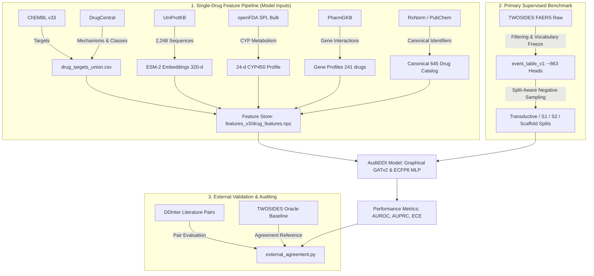

# An Auditable Graphical Fingerprint Framework for Cold-Start Drug-Drug Interaction Prediction: Dataset Master Plan & Implementation Roadmap

This document serves as the **internal engineering checklist, implementation roadmap, and dataset lifecycle tracker** for **AuditDDI: An Auditable Graphical Fingerprint Framework for Cold-Start Drug-Drug Interaction Prediction**. It details the operational status, source paths, preprocessing scripts, and downstream integration for all 14 evaluated datasets.

---

## 1. Guiding Operational Principles

Every dataset evaluated for AuditDDI is categorized under one of three strict operational roles to prevent data leakage and maintain benchmark integrity:

1. **Feature Input (Single-Drug Entity)**:
   Describes a single drug's chemical, genomic, or enzymatic properties (e.g., SMILES, targets, CYP profiles, ESM-2 embeddings). Can be safely ingested during training.
2. **Evidence / Validation (Pair-Level Entity)**:
   Describes pairwise clinical interactions or literature consensus. Strictly sequestered from model training features to eliminate pairwise ground truth leakage.
3. **Dropped / Deprecated**:
   Datasets eliminated due to severe sparsity, high noise, redunancy, or biological mismatch with small-molecule DDI mechanisms.

---

## 2. Comprehensive Master Dataset Tracking Table

| Dataset | Role in Pipeline | Scope & Catalog Coverage | Status | Preprocessing Script / Ingestion Artifact | Next Engineering Action |
| :--- | :--- | :--- | :---: | :--- | :--- |
| **TWOSIDES** | Supervised Labels | 645 drugs, 63,473 positive pairs, 4.65M records, ~863 event heads | **100% Complete** | `src/features/event_table.py` $\to$ `event_table_v1` | Production labels frozen; negative sampling verified. |
| **ChEMBL** | Target Features | Human target proteins for small molecules | **100% Complete** | Extracted human targets into `drug_targets_union.csv` | Active in `features_v3`. |
| **DrugCentral** | Target & Class Features | Target mechanisms, ATC classes, target families | **100% Complete** | Combined into `drug_targets_union.csv` (565 drugs, 23 target classes) | Active in `features_v3`. |
| **RxNorm** | Identity & ATC Classes | Concept mapping, ATC hierarchies | **75% Complete** | `src/features/rxnorm_by_name.py` | Complete remaining brand-name resolutions to maximize ATC feature block. |
| **PharmGKB** | Gene Features | Drug-gene & enzyme interaction profiles | **100% Complete** | `pharmgkb_twosides_gene_profiles.csv` (241 drugs, 1,233 genes) | Active in `features_v3`. |
| **UniProt** | Target Sequences | Sequence retrieval for all 2,288 targets | **98.3% Complete** | `src/features/uniprot_sequences.py` (2,248 / 2,288 targets fetched) | 40 obsolete accessions recorded in unmapped manifest. |
| **ESM-2** | Target Language Model | `esm2_t6_8M_UR50D` protein embeddings | **100% Complete** | `src/features/esm_embeddings.py` (2,248 proteins embedded, 563 drugs covered) | Active in `features_v3`. |
| **openFDA Bulk** | Evidence & CYP Metabolism | SPL interaction text & 24-d CYP profile | **85% Complete** | Extracted 24-d CYP vector across 406 drugs in `label_features.csv` | Build SPL interaction text parser for UI evidence packs. |
| **DDInter** | External Validation | Literature-curated interaction pairs across 14 categories | **70% Complete** | `src/evidence/external_agreement.py` benchmarked across 8 categories | Download remaining 6 categories (C, G, J, M, N, S) to achieve 14/14. |
| **PubChem** | Chemical Identity & Synonyms | InChIKeys, canonical SMILES, synonyms | **90% Complete** | `src/features/pubchem_names.py` resolves remaining synonym aliases | Complete name resolution pass for frontend query suggestions. |
| **DailyMed** | Label Evidence | Structured Product Labels (SPL) | **Dropped / Redundant** | Overlapped by openFDA bulk SPL repository | Dropped; openFDA bulk covers all contents. |
| **BindingDB** | Quantitative Affinities | $K_i, K_d, \text{IC}_{50}$ binding affinities | **Optional / Deferred** | Preliminary parsing indicated severe missingness across 645 drugs | Deferred until high-resolution affinity study. |
| **FAERS** | Auxiliary Toxicity Head | Spontaneous adverse event reports | **Ablation Only** | Built auxiliary single-drug toxicity heads in `ddi_model.py` | Kept only as ablation; shares underlying distribution with TWOSIDES. |
| **GEO** | Transcriptomics | Gene expression profiles | **Dropped** | Represents disease tissue RNA-seq, not drug perturbations | Dropped (would require LINCS L1000 drug perturbagen signatures). |
| **PDB** | 3D Structural Targets | Experimental co-crystal structures | **Dropped** | High-resolution ligand-bound complexes available for <1% of pairs | Dropped; reserved for future 3D docking research. |

---

## 3. Detailed Dataset Ingestion Status & Specifications

### 3.1 Primary Label Datasets

#### TWOSIDES (`labels`)
- **Location**: Google Drive `data/twosides/twosides.csv.gz`
- **Catalog**: 645 drugs mapped to CID, 63,473 positive pairs, 4,649,441 records across 1,317 raw event types.
- **Frozen Vocabulary**: 863 adverse event heads occurring $\ge 500$ times.
- **Negative Control Formulation**: Balanced 1:1 split-aware negative sampling without replacement from unobserved pairs in each partition.
- **Status**: **100% Complete**.

#### DDInter (`external_validation`)
- **Location**: Google Drive `data/ddinter/`
- **Catalog**: Curated clinical interaction pairs across categories A–V (382,618 pairs total).
- **Current Coverage**: 8 categories downloaded and evaluated:
  - `A_ddinter_downloads.csv`
  - `B_ddinter_downloads.csv`
  - `D_ddinter_downloads.csv`
  - `E_ddinter_downloads.csv`
  - `H_ddinter_downloads.csv`
  - `L_ddinter_downloads.csv`
  - `P_ddinter_downloads.csv`
  - `R_ddinter_downloads.csv`
- **Pending Categories**: C, G, J, M, N, S.
- **Status**: **70% Complete**.

---

### 3.2 Biological & Pharmacokinetic Feature Stores

#### ChEMBL & DrugCentral (`features/targets`)
- **Files**: `drug_targets_union.csv`, `drug_target_classes.csv`
- **Coverage**: 565 of 645 drugs have verified human target annotations; 23 target families (GPCRs, Kinases, Ion Channels, Nuclear Receptors, etc.).
- **Status**: **100% Complete**.

#### UniProtKB & ESM-2 (`features/esm`)
- **Sequence Script**: `src/features/uniprot_sequences.py`
  - Evaluated on Colab: Fetched 2,248 sequences out of 2,288 targets (98.25% coverage).
  - 40 obsolete/deleted UniProt accessions flagged in `missing_uniprot_accessions.txt` (not imputed).
- **Embedding Script**: `src/features/esm_embeddings.py`
  - Ran on Google Colab T4 GPU using Facebook ESM-2 (`esm2_t6_8M_UR50D`).
  - Generated 320-dimensional contextual protein embeddings.
  - Aggregated per drug via Mechanism of Action (MoA) weighting, covering 563 drugs.
- **Status**: **100% Complete**.

#### openFDA Bulk SPL (`features/cyp` & `evidence`)
- **CYP Profile**: Ingested 24-dimensional binary feature vector (8 CYP isoforms $\times$ 3 roles: substrate, inhibitor, inducer) covering 406 drugs.
- **Status**: Feature store integration **100% Complete**; UI text evidence parser **85% Complete**.

#### PharmGKB (`features/genes`)
- **Files**: `pharmgkb_twosides_gene_profiles.csv`
- **Coverage**: 241 drugs, 1,233 pharmacogenes and enzymes.
- **Status**: **100% Complete**.

---

## 4. Pending Implementation Checklist

- [ ] **DDInter Full Category Download**:
  - Download categories C, G, J, M, N, S from DDInter to achieve complete 14/14 category coverage.
  - Run `src/evidence/external_agreement.py` against all 14 categories.
- [ ] **openFDA SPL Evidence Text Parser**:
  - Implement regex extractor for Section 7 ("DRUG INTERACTIONS") of FDA Structured Product Labels.
  - Expose parsed text excerpts in the evidence pack API endpoint (`/api/v1/predict`).
- [ ] **RxNorm Brand-Name Normalization Pass**:
  - Re-query unmapped drug brand names to maximize ATC block representation in the feature store.
- [ ] **Platt Calibration & Conformal Prediction Sets**:
  - Run temperature/Platt scaling across `baselines_acct1` and `multilabel_acct1` on Colab to compute calibrated probabilities and conformal confidence intervals ($1 - \alpha = 0.90$).
- [ ] **5-Seed Benchmark Aggregation**:
  - Execute multi-seed runs (Seeds 11, 23, 37, 53, 71) across S1, S2, transductive, and scaffold splits to generate mean $\pm$ standard deviation tables for the publication.
