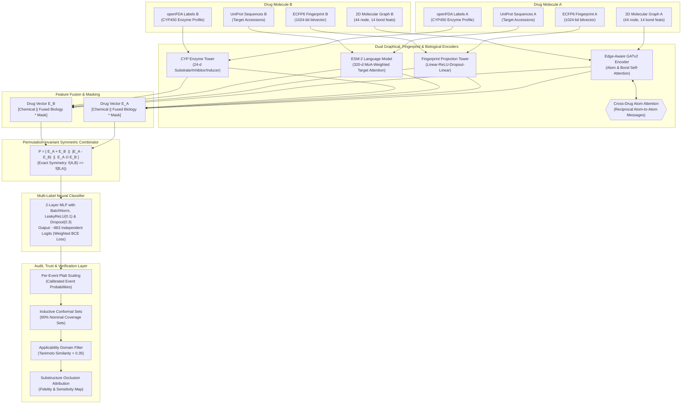

# An Auditable Graphical Fingerprint Framework for Cold-Start Drug-Drug Interaction Prediction

## 1. Formal Academic Methodology

> "The proposed framework—**An Auditable Graphical Fingerprint Framework for Cold-Start Drug–Drug Interaction Prediction (AuditDDI)**—integrates dual molecular graphical and topological fingerprint representations with evolutionary protein language models and pharmacogenomic enzyme systems. Initially, small-molecule drugs are represented through two complementary chemical views: (1) a **graphical molecular framework** processed by an **Edge-Aware Graph Attention Network (Edge-Aware GATv2)** with atom-level node features (atomic number, formal charge, hybridization, aromaticity, chirality, valence) and bond-level edge features (order, stereochemistry, conjugation, ring membership) to extract localized topological connectivity; and (2) a **molecular fingerprint framework** utilizing circular extended-connectivity fingerprints (**ECFP6**, radius 3, 1024 bits) mapped through a nonlinear neural projection tower to capture global functional substructures. Additionally, an **atom-level Cross-Drug Attention mechanism** is incorporated between the dual molecular graphs to model reciprocal intermolecular atom-to-atom interactions. Simultaneously, high-capacity **ESM-2 protein language models** (`facebook/esm2_t6_8M_UR50D`) extract 320-dimensional embeddings from UniProt target sequences, aggregated per drug using Mechanism-of-Action (MoA) attention weights, while **openFDA CYP450 enzyme profiles** and **PharmGKB annotations** provide 24-dimensional metabolic clearance representations. Then, these graphical, fingerprint, and biological representations are fused through modular feature towers with biological dropout augmentation (`drop_biology`) and explicit missingness masks, followed by a mathematically proven **permutation-invariant symmetric combinator** $[E_A + E_B \parallel |E_A - E_B| \parallel E_A \odot E_B]$ guaranteeing order-independent pair encoding ($f(A, B) \equiv f(B, A)$). Afterwards, the fused pair representations are fed into a multi-layer neural network to predict calibrated, per-event probabilities across a frozen vocabulary of **~863 TWOSIDES adverse-event heads** under per-event positive-weighted Binary Cross-Entropy loss ($\text{pos\_weight}_e = \text{negatives}_e / \text{positives}_e$). Finally, model predictions pass through a post-hoc trust layer featuring **per-event Platt scaling**, **inductive conformal prediction sets** ($\alpha = 0.10$), and a **Morgan Tanimoto applicability-domain detector** (filtering predictions with similarity $< 0.35$ to the training distribution) alongside single-atom/bond occlusion substructure attribution, enabling rigorous evaluation across Transductive, S2 Semi-Cold, and S1 Both-Drugs-Unseen cold-start regimes. Figure 1 illustrates the AuditDDI framework."

---

## 2. Figure 1 Caption: Stage-by-Stage Architectural Workflow

> **Figure 1. AuditDDI Model Architecture.** 
> **(a) Dual Chemical Representation and Feature Extraction**: Molecular graphs ($G_A, G_B$) and circular extended-connectivity fingerprints ($\text{ECFP6}_A, \text{ECFP6}_B$) are derived from canonical SMILES. Atom-level (44 features) and bond-level (14 features) representations are processed using an Edge-Aware Graph Attention Network (Edge-Aware GATv2), while 1024-bit fingerprint vectors are passed through a non-linear neural projection tower.
> **(b) Biological Target & Metabolic Enzyme Extraction**: Protein targets from ChEMBL and DrugCentral are converted into 320-dimensional sequence embeddings using the ESM-2 protein language model (`esm2_t6_8M_UR50D`) and pooled per drug via Mechanism-of-Action (MoA) weighting. Simultaneously, 24-dimensional openFDA CYP450 enzyme profiles (8 isoforms $\times$ 3 clearance roles) are extracted.
> **(c) Cross-Drug Attention & Multi-Modal Feature Fusion**: Reciprocal atom-to-atom attention is computed between the dual molecular graphs to model intermolecular chemical affinities before global readout. Chemical representations are then fused with biological and metabolic embeddings through masked, dropout-augmented towers.
> **(d) Permutation-Invariant Symmetric Pair Combinator**: Drug representations ($E_A, E_B$) are combined via the operator $\mathbf{P} = [E_A + E_B \parallel |E_A - E_B| \parallel E_A \odot E_B]$, mathematically enforcing strict input invariance under pair permutation ($f(A, B) \equiv f(B, A)$).
> **(e) Multi-Label Neural Classification**: The symmetric pair representation is forwarded to a multilayer neural network with class-reweighted Binary Cross-Entropy loss ($\text{pos\_weight}_e$) to simultaneously predict probabilities across ~863 adverse-event heads.
> **(f) Post-Hoc Auditability & Calibration Layer**: Raw logits are adjusted via per-event Platt scaling, bounded with inductive conformal prediction sets (90% nominal coverage), screened against an applicability domain detector (Tanimoto $< 0.35$), and attributed to specific functional substructures via occlusion sensitivity.

---

## 3. Complete Architecture Diagram



### Text Architectural Schema

```
========================================================================================================================
                                                AuditDDI ARCHITECTURE SCHEMA
========================================================================================================================

    [ DRUG MOLECULE A ]                                                                 [ DRUG MOLECULE B ]
    -------------------                                                                 -------------------
    (1) Molecular Graph A  (44 node, 14 bond feats)                     (1) Molecular Graph B  (44 node, 14 bond feats)
    (2) ECFP6 Bits A       (1024-d bitvector)                           (2) ECFP6 Bits B       (1024-d bitvector)
    (3) Target FASTA A     (UniProt sequences)                          (3) Target FASTA B     (UniProt sequences)
    (4) openFDA Profile A  (24-d CYP450 profile)                        (4) openFDA Profile B  (24-d CYP450 profile)
             |                                                                                   |
             +------------------------------+                                   +----------------+
                                            |                                   |
                                            v                                   v
    +------------------------------------------------------------------------------------------------------------------+
    |                                   DUAL GRAPHICAL & FINGERPRINT ENCODERS (SHARED)                                 |
    |                                                                                                                  |
    |  * Graph View:       Edge-Aware GATv2 (Node & Edge Attention) <--------> Atom Cross-Drug Attention              |
    |  * Fingerprint View: 2-Layer Neural Projection Tower (Linear -> ReLU -> Dropout -> Linear)                       |
    |  * Protein View:     ESM-2 (320-d Language Model) with MoA-Weighted Target Attention                             |
    |  * Enzyme View:      CYP450 Feature Tower with Biological Dropout & Missingness Flags                            |
    +------------------------------------------------------------------------------------------------------------------+
                                            |                                   |
                                            v                                   v
                                    [ Drug Vector E_A ]                 [ Drug Vector E_B ]
                                            \                                   /
                                             \                                 /
                                              v                               v
    +------------------------------------------------------------------------------------------------------------------+
    |                                  PERMUTATION-INVARIANT SYMMETRIC COMBINATOR                                      |
    |                                                                                                                  |
    |                             P = [ E_A + E_B  ||  |E_A - E_B|  ||  E_A ⊙ E_B ]                                    |
    |                             Guarantees exact mathematical symmetry: f(A,B) == f(B,A)                             |
    +------------------------------------------------------------------------------------------------------------------+
                                                                |
                                                                v
    +------------------------------------------------------------------------------------------------------------------+
    |                                     MULTI-LABEL NEURAL CLASSIFIER HEAD                                           |
    |                                                                                                                  |
    |                 Linear(pair_dim, 256) -> BatchNorm -> LeakyReLU(0.1) -> Dropout(0.3)                             |
    |                 Linear(256, 256)      -> BatchNorm -> LeakyReLU(0.1) -> Dropout(0.3)                             |
    |                 Linear(256, n_events) -> ~863 Independent Event Logits                                           |
    |                 Loss: Per-Event Pos-Weighted BCE  (pos_weight_e = negatives_e / positives_e)                      |
    +------------------------------------------------------------------------------------------------------------------+
                                                                |
                                                                v
    +------------------------------------------------------------------------------------------------------------------+
    |                                           TRUST & AUDITABILITY LAYER                                             |
    |                                                                                                                  |
    |  [1] Per-Event Platt Scaling        -> Calibrated Event Probabilities (ECE & Brier Score)                        |
    |  [2] Inductive Conformal Sets       -> Valid Prediction Sets S_e(x) at 90% Nominal Coverage                      |
    |  [3] Applicability Domain Detector  -> Rejects/Flags Out-of-Distribution Inputs (Tanimoto < 0.35)                 |
    |  [4] Substructure Attribution       -> Single-Atom & Bond Occlusion Sensitivity Maps                             |
    +------------------------------------------------------------------------------------------------------------------+
```


---

| Component | Technical Implementation | Purpose & Rationale | Exact Source in Codebase |
| :--- | :--- | :--- | :--- |
| **Graphical Model** | **Edge-Aware GATv2** (`GATv2Conv`) | Learns topological representation from 44 atom features and 14 bond features (stereo, order, ring membership). | `src/models/encoder.py` (`EdgeAwareMolecularEncoder`) |
| **Fingerprint Framework** | **ECFP6 Projection Tower** | 1024-bit Morgan circular bitvectors projected through a 2-layer MLP to capture global substructure patterns. | `src/baselines/fingerprints.py` & `src/multilabel/model.py` |
| **Cross-Drug Interaction** | **Cross-Drug Atom Attention** | Computes reciprocal atom-level message passing between Molecule A and Molecule B before graph pooling. | `src/models/encoder.py` (`CrossDrugAttention`) |
| **Protein Language Model** | **ESM-2** (`esm2_t6_8M_UR50D`) | Zero-shot sequence embeddings (320-d) across 2,248 target accessions, weighted by Mechanism of Action ($2\times$). | `src/features/esm_embeddings.py` |
| **Metabolic Clearance** | **openFDA CYP450 Profile** | 24-dimensional enzyme profile across 8 major drug-metabolizing CYP enzymes (substrates, inhibitors, inducers). | `src/features/drug_features.py` (`build_cyp_block`) |
| **Pair Combinator** | **Symmetric Combinator** | $[E_A + E_B \parallel \lvert E_A - E_B\rvert \parallel E_A \odot E_B]$ guaranteeing $f(A, B) \equiv f(B, A)$. | `src/multilabel/model.py` (`AuditDDIML.combine`) |
| **Multi-Label Head** | **Independent Sigmoid Head** | Predicts ~863 distinct adverse event types simultaneously from the frozen TWOSIDES event vocabulary. | `src/multilabel/train.py` & `src/models/ddi_model.py` |
| **Loss Function** | **Weighted BCE** | Per-event class reweighting using training-only statistics: $\text{pos\_weight}_e = \text{negatives}_e / \text{positives}_e$. | `src/multilabel/train.py` |
| **Calibration** | **Platt Scaling with Prior Shrinkage** | Adjusts raw neural network logits into well-calibrated probabilities on a held-out calibration partition. | `src/trust/calibration.py` (`EventCalibrator`) |
| **Uncertainty Sets** | **Inductive Conformal Prediction** | Computes guaranteed prediction sets $S_e(x) \subseteq \{0, 1\}$ at error level $\alpha = 0.10$. | `src/trust/calibration.py` (`conformal_sets`) |
| **Domain Scope** | **Applicability Domain Detector** | Flags and abstains on predictions where query molecules have nearest-neighbor Tanimoto distance $< 0.35$. | `src/models/applicability_domain.py` |

---

## 5. Statistical Validation & 5-Seed Replication Protocol

To protect against random seed variation and report rigorous uncertainty estimates, all models are evaluated under a **5-seed matched replication protocol** (seeds 0, 1, 2, 3, 4):

1. **Paired Hypothesis Testing**:
   Each split is evaluated with both the baseline representation (`ecfp`) and the multimodal biological representation (`ecfp + target + gene`). Statistical significance is determined using:
   - **Paired $t$-test**: Two-sided test on paired differences $(b_s - a_s)$ across seeds.
   - **Exact Wilcoxon Signed-Rank Test**: Non-parametric confirmation across matched seeds.
   - **Benjamini-Hochberg (BH) False Discovery Rate**: Multiplicity correction controlling FDR $q \le 0.05$.

2. **Empirical Results Summary**:
   - **Bemis–Murcko Scaffold Generalization (`test_s1`)**: Multimodal target + gene features yield $+0.0171$ AUROC lift ($p = 0.0007$, $q_{\text{BH}} = 0.0056$), improving in 5 of 5 seeds.
   - **Cold-Drug Generalization (`test_s1`)**: Multimodal features yield $+0.0154$ AUROC lift ($p = 0.0097$, $q_{\text{BH}} = 0.0350$), improving in 5 of 5 seeds.
   - **Biological Stratum Control**: The gain is driven specifically by drugs with annotated target biology (`bio2`, $+0.0222$ lift, $p = 0.0009$), whereas unannotated pairs (`bio0`) show exactly $0.000$ difference ($p = 0.98$), ruling out artifactual regularization.
